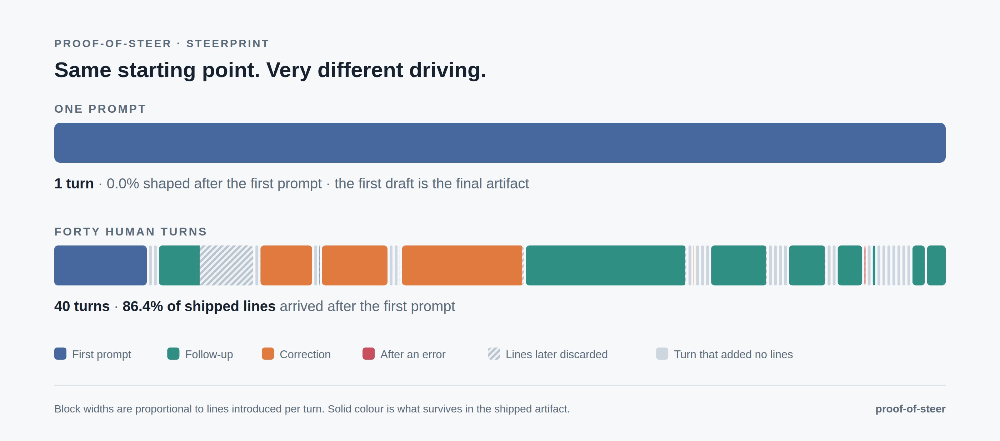
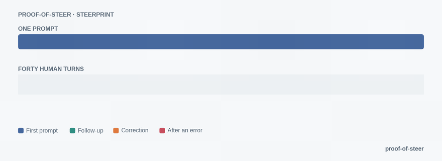

# proof-of-steer

**Steered, not slop.**

A local receipt that shows how much a human actually steered the AI that made this, so the reader knows how hard to review it.



*One prompt on top, one block. Below it, a real steered session: forty human turns, drawn from its receipt.*

## For maintainers and reviewers

AI-produced pull requests and documents now arrive faster than anyone can read them, and from the outside a one-prompt artifact and a carefully steered one look exactly the same. proof-of-steer gives you a way to tell them apart before you spend your attention. Ask contributors to attach a steering receipt to their pull request, the way they attach test results. The receipt reports what observably happened while the artifact was made: how many genuine human turns there were, how much of the shipped artifact arrived only after the first prompt, which parts were reshaped in later revisions, and where the corrections landed. You price your review against evidence instead of a vibe, and careful contributors finally have a way to prove the care.

The wedge is influence, not authorship. Tools that label lines as human-typed or agent-typed cannot separate a one-prompt artifact from a heavily steered one, because in an agent session the agent types nearly everything either way. Steering is the signal that separates them, and steering is what this measures. A receipt is descriptive evidence, never a certified grade.

## For creators

If you steer your agent hard, correcting, rejecting, and reshaping until the work is yours, a receipt is how that work becomes visible. Attach it to the pull request, the document, or the delivery. The map form of the receipt is called a Steerprint, and it is made to be shared.

## See it first: the Steerprint

Open [examples/collaboration-map.html](examples/collaboration-map.html) in a browser. It is one self-contained page with no external assets, drawn from the sample receipts in this repo. Its title is Steerprint, and proof-of-steer is the tool that generates it.

On the left, a steered coding session drawn as a 40-block timeline, one block per human turn, colored by kind (first prompt, follow-up, correction, after-error) and hatched where those lines were later discarded. On the right, a one-prompt control: a single block. Below, a research findings draft drawn as its sections, colored first-draft versus shaped-by-later-revisions: the phase one sections sit almost entirely untouched, one section arrived whole in revision 2, and the whole phase two was appended in revision 3.

Any receipt can be drawn this way:

```bash
python3 steering_viz.py my-session.receipt.json -o steerprint.html
```

## Quickstart

Requirements: Python 3.8 or later (standard library only) and git on PATH. Nothing is uploaded anywhere.

Run it without installing anything, if you have [uv](https://docs.astral.sh/uv/):

```bash
uvx proof-of-steer code path/to/session.jsonl --label my-session
```

Or install it:

```bash
pipx install proof-of-steer
# or: pip install proof-of-steer
```

Or run it from a clone of this repo, where the commands below use `python3 steering_receipt.py` in place of `proof-of-steer`, and `python3 steering_viz.py` in place of `steerprint`. The two forms are the same tool.



*The same session, building turn by turn. The one-prompt control never grows.*

### Code mode: a coding agent session

```bash
python3 steering_receipt.py code path/to/session.jsonl --label my-session
```

Claude Code transcripts and Codex rollouts are both supported. The format is detected automatically, or it can be forced with `--format codex` or `--format claude-code`.

Add `--repo` to seed the starting content of files the session edited but never created, so more of its edits can be replayed:

```bash
python3 steering_receipt.py code path/to/session.jsonl --label my-session --repo path/to/repo
```

If the repo has moved on since the session ran, seed from the commit the session ran against instead of the working tree of today:

```bash
python3 steering_receipt.py code path/to/session.jsonl --label my-session --repo path/to/repo --repo-ref <commit>
```

The transcript is replayed turn by turn into a reconstructed local git repo, one commit per human-turn segment, and `git blame` on the result cross-checks the line provenance the replay computed in memory. Output lands in `receipts-out/` as `my-session.receipt.json` plus a rendered `my-session.STEERING.md`.

What the samples in [examples/](examples/) show:

- **Steered session** (`code-steered-860618e1`): 40 human turns, 12 of them correction prompts. **86.4%** of the shipped lines were introduced after the first prompt. Line authorship alone would call every line agent-typed and stop there.
- **One-prompt control** (`code-oneprompt-4130c9a7`): 1 human turn. **0.0%** of the shipped lines arrived after the first prompt. Same authorship label as the steered session, completely different receipt.

### Doc mode: a document in git

```bash
python3 steering_receipt.py doc path/to/repo docs/plan.md --label plan
```

Doc mode walks the document's revision history and maps, per section, what survives verbatim from the first version and what each later revision introduced. The history comes from a provider: git by default, a Google Doc through the Drive connector export, or a folder of versioned files. The receipt records the provider, whether the history it saw was complete, and the authors it lists.

The sample (`doc-steered-findings-draft`) covers 3 revisions of a research findings draft and 242 nonblank lines in its final version: **at least 36.0%** of the final text survives verbatim from the first version. The per-section map is where the story is: the phase one sections are 100% first draft, the cost estimate section first appears in revision 2, and every phase two section arrives in revision 3.

### More flags

```bash
# bind a receipt to its exact source material with SHA-256 hashes (both modes)
python3 steering_receipt.py code path/to/session.jsonl --label my-session --commitment
python3 steering_receipt.py doc path/to/repo docs/plan.md --label plan --commitment

# choose a history provider and a sectioning strategy (doc mode)
python3 steering_receipt.py doc path/to/folder --label plan --provider folder --section-strategy auto

# draw the steering mark of any receipt as a small badge for a pull request or README
python3 steering_viz.py my-session.receipt.json --badge -o badge.svg
```

`--section-strategy` is `auto` by default: markdown headings when the text carries them, a conservative heading detection when it does not, and one whole-document section when neither applies. The strategy that ran is recorded on the receipt.

## What the receipt fields mean

Plain-word version. The full field-by-field contract is [SCHEMA.md](SCHEMA.md) (schema id `proof-of-steering/receipt@1.0`).

- **Steering mark**: one of four words at the top of every receipt: One-shot, Prompted, Steered, or Closely steered. The mark is computed from the presence-level fields only. For code it counts how many turns reshaped earlier work. For documents it looks at how the later revisions treated the first version. It names the shape of the process, and it is not a grade: it says nothing about how good the artifact is, and one-shot work can be exactly right.
- **Human turns**: genuine human prompts, with injected system records filtered out. The basic unit of steering.
- **Post-first-prompt share** (code): the share of shipped lines whose origin is a segment after the first artifact-producing one. 0% means the shipped artifact is the first prompt's output, untouched in origin. This is the headline field.
- **Per-segment and per-file attribution** (code): which turns and which files the surviving lines came from, including how much came from correction and after-error segments.
- **Coverage**: how much of the session the reconstruction could actually replay. A low-coverage receipt should be discounted by its reader, so the number is printed on every receipt.
- **Unchanged share** (doc): at least this share of final lines survives verbatim from the first version. It is a floor, not a point estimate, and it is only interpretable next to the revision count printed with it. A sentence-level share is reported alongside for prose.
- **Per-section map** (doc): for each section, how much is unchanged from the first version and which revisions introduced the rest.
- **Context fields**: first-segment survival and correction-segment share are reported but demoted. Survival saturates near 100% on greenfield work, and the correction share is noisy in both directions. Each field says so in the schema.

## Validation

The field set was not asserted. It was tested, and some of it failed and got demoted.

| Corpus | What was tested | Result |
|---|---|---|
| trace-commons, 28 Claude Code sessions | Full transcript-to-git join, replay provenance checked against `git blame` | Blame agreement 99.5 to 100%. Steered sessions separate from one-prompt controls on the headline field (batch medians 0.0% for sessions of 2 turns or fewer, 77.2% for 10 or more) |
| SWE-chat (SALT-NLP), 17,968 sessions | Published steering statistics reproduced at scale | Steering presence validated, dose not: one-prompt sessions sit at 0.0, continued sessions near 0.75, pushback sessions near 0.97, and the value saturates. Published survival not reproduced, so survival stays a context field, stratified by agent |
| CoAuthor, 1,447 writing sessions (CHI 2022) | Doc mode against keystroke-level ground truth: hide the keystrokes, keep only snapshots, score the map | Per-part labels validated: 88.3% sentence-level agreement, false-untouched rate about 0.05%. The headline percentage is a floor, not a dose |

Full reports and methods live with the project history. The current validated scope is also printed on every receipt in its `validation_scope` field.

## Limitations, stated plainly

- **Presence, not dose.** The headline field reliably detects that steering happened. It does not measure how much steering is worth, and it saturates on long sessions. Do not read it as a score.
- **The doc-mode rejection blind spot.** Revision history only shows what was written and later changed. Rejected suggestions and dismissed drafts never enter the history, so doc-mode steering evidence is a lower bound on interaction. A quiet history does not prove a quiet process.
- **Per-harness numbers do not pool.** Pushback and survival rates differ sharply by agent harness (in SWE-chat, pushback runs 21% for one agent to 60% for another). Receipts carry a `harness` field, and those context fields should only be compared within one harness.
- **Reconstruction is partial.** Edit replay can miss edits whose base it cannot establish. That is why coverage is a headline field rather than a footnote.

## The bound this design respects

Purdue's "Likelihood Is Not Authorship" (arXiv:2610.19767) shows that transcript-only likelihood scores cannot certify who authored a text. proof-of-steer stays inside that bound: it makes no authorship claim and computes no probability that a human wrote something. It counts observable events (turns, corrections, revision provenance) and reports them as evidence a person can weigh.

## Your transcript is the private key. The receipt is the public one.

proof-of-steer is private by construction, not by policy. Everything runs on your machine and nothing is uploaded anywhere. What leaves the machine is only what you choose to attach to the work: the receipt.

A session transcript is radioactive. It holds your code, your other projects, your half-formed thinking, and whatever you pasted at 1am. You could share it to prove you steered, the same way you could prove your identity by handing over your private key. Nobody sane does either. The receipt is derived from that private material and is safe to publish for the same reason a public key is. It carries counts, categories, file names, and line attributions, and never prompt text, tool arguments, or file contents. Anyone can check every claim on it without seeing the session it came from. Sharing is per artifact and sender-controlled. You publish a receipt for this pull request and everything else stays private.

One honest break in the analogy, stated plainly. A public key is unforgeable and a receipt is not. It is descriptive evidence, not a cryptographic proof, and a determined faker can manufacture one. Part of that gap closes with `--commitment`. Run with that flag, the receipt carries SHA-256 hashes of the exact transcript and repo state it was derived from, computed in the same run. Commit now, reveal only if challenged. If a claim is ever disputed, the sender reveals the material and anyone can verify the receipt was honestly derived from it rather than written after the fact. Share the receipt, keep the session.

## Tests

```bash
python3 -m unittest discover -s tests
```

Thirty-six tests, standard library only, including fixtures that pin the seeding behavior, the sentence-share computation, the floor wording on rendered receipts, the Codex adapter, the provider registry and fixture histories, the impact classification, the steering mark boundaries, and the hash-commitment round trip.

## License

MIT. See [LICENSE](LICENSE).
